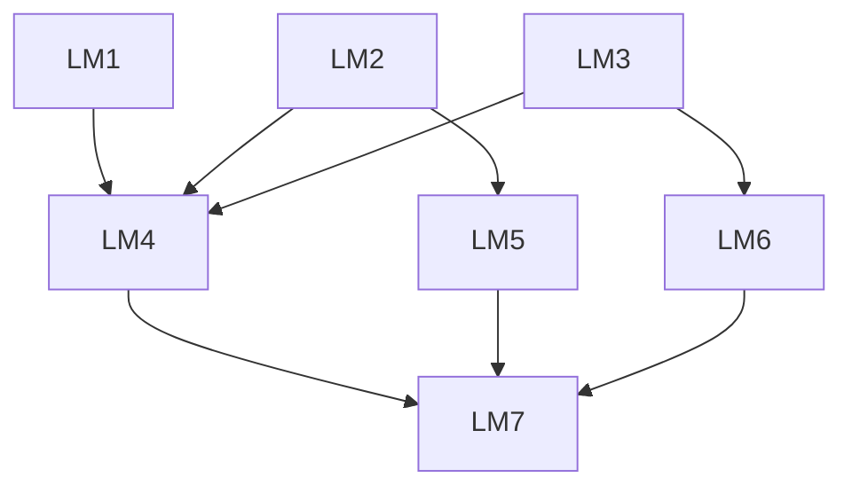
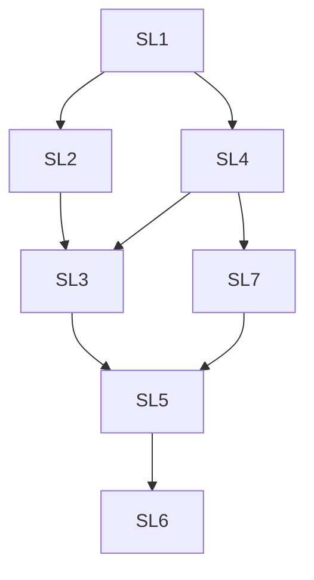
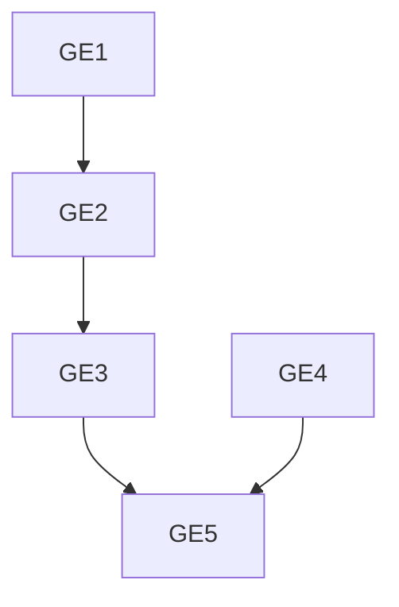
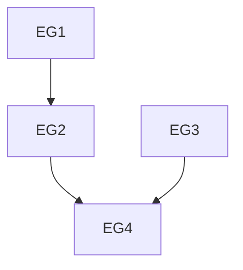

# Domains and prerequisite structures

An arrow A → B means that A is a prerequisite of B. Graphs show direct relations; prerequisites apply transitively.

| Domain | Components | Direct relations | States |
| --- | ---: | ---: | ---: |
| Linear Modelling | 7 | 8 | 23 |
| Slope | 7 | 8 | 11 |
| Graph to Equation | 5 | 4 | 9 |
| Equation to Graph | 4 | 3 | 7 |

## Linear Modelling

| ID | Knowledge component |
| --- | --- |
| LM1 | State the general equation of a linear function using m for the slope and c for the y-intercept. |
| LM2 | Identify the slope m in the equation of a linear function when its slope and y-intercept are given. |
| LM3 | Identify the y-intercept c in the equation of a linear function when its slope and y-intercept are given. |
| LM4 | Write the equation of a linear function in the form y = mx + c when its slope m and y-intercept c are given. |
| LM5 | Determine the slope m, representing the rate of change, from a contextual description of a linear relationship with an initial value. |
| LM6 | Determine the y-intercept c, representing the initial value, from a contextual description of a linear relationship. |
| LM7 | Express a contextual description of a linear relationship with an initial value as an equation in the form y = mx + c. |

**Direct prerequisites:** LM1 → LM4; LM2 → LM4; LM2 → LM5; LM3 → LM4; LM3 → LM6; LM4 → LM7; LM5 → LM7; LM6 → LM7.

## Slope

| ID | Knowledge component |
| --- | --- |
| SL1 | Draw a slope triangle that can be used to determine the slope of an increasing linear function from its graph. |
| SL2 | Draw a slope triangle that can be used to determine the slope of a decreasing linear function from its graph. |
| SL3 | Determine the slope of a decreasing linear function from a given slope triangle. |
| SL4 | Determine the slope of an increasing linear function from a given slope triangle. |
| SL5 | Determine a negative slope value from a given slope triangle. |
| SL6 | Determine the equation of a linear function from its graph. |
| SL7 | Determine a positive slope value from a given slope triangle. |

**Direct prerequisites:** SL1 → SL2; SL1 → SL4; SL2 → SL3; SL3 → SL5; SL4 → SL3; SL4 → SL7; SL5 → SL6; SL7 → SL5.

## Graph to Equation

| ID | Knowledge component |
| --- | --- |
| GE1 | Construct a grid-aligned slope triangle on a given line. |
| GE2 | Read the slope from a given slope triangle. |
| GE3 | Determine the equation y = mx from a graph. |
| GE4 | Read the y-intercept from a graph. |
| GE5 | Determine the equation y = mx + b from a graph. |

**Direct prerequisites:** GE1 → GE2; GE2 → GE3; GE3 → GE5; GE4 → GE5.

## Equation to Graph

| ID | Knowledge component |
| --- | --- |
| EG1 | Construct a slope triangle for a given slope value. |
| EG2 | Plot the line y = mx in a coordinate system. |
| EG3 | Plot the y-intercept for a given value of b. |
| EG4 | Plot the line y = mx + b in a coordinate system. |

**Direct prerequisites:** EG1 → EG2; EG2 → EG4; EG3 → EG4.

## Data files

- `domains.csv`: domain names, versions and sizes.
- `items.csv`: component identifiers and descriptions.
- `cover_relations.csv`: direct prerequisite relations.
- `*_surmise_matrix.csv`: reflexive, transitive closure; row = prerequisite, column = target.
- `ground_truth.json`: all admissible states and their outer fringes.
- `knowledge_states.csv`: tabular state and fringe sets; `|` separates identifiers, an empty field denotes the empty set.
